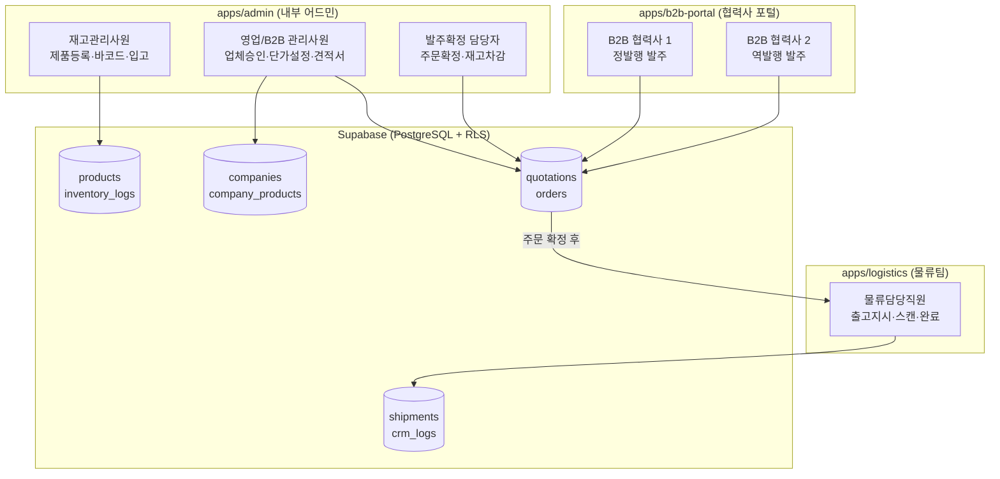
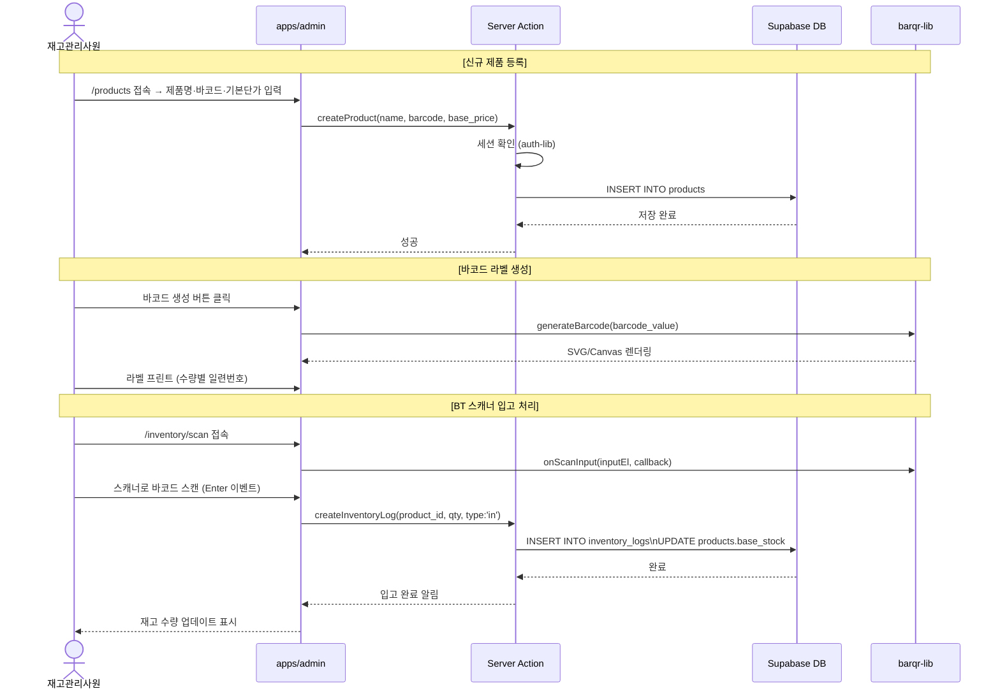
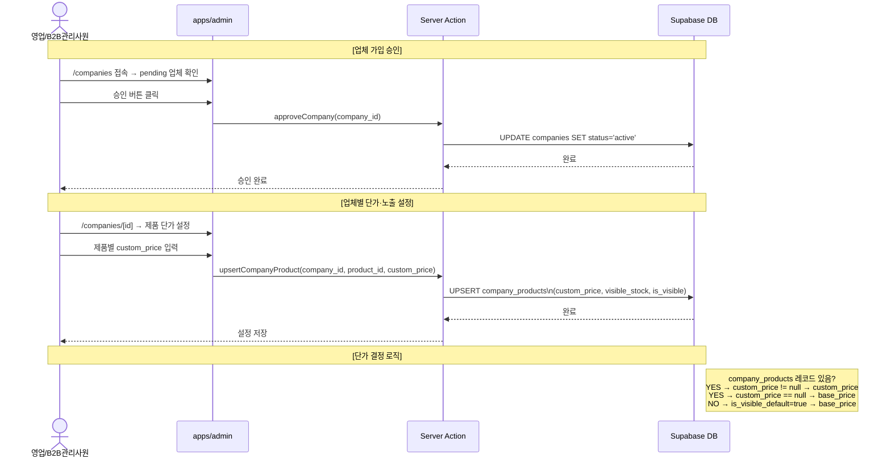
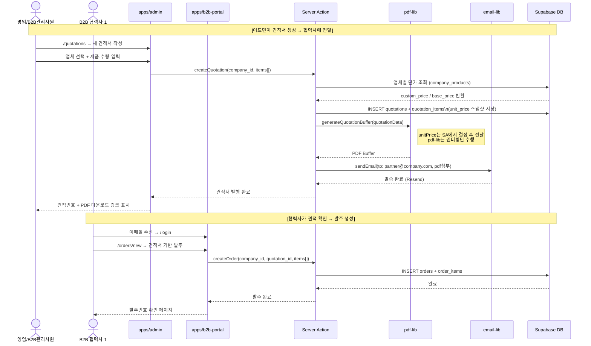
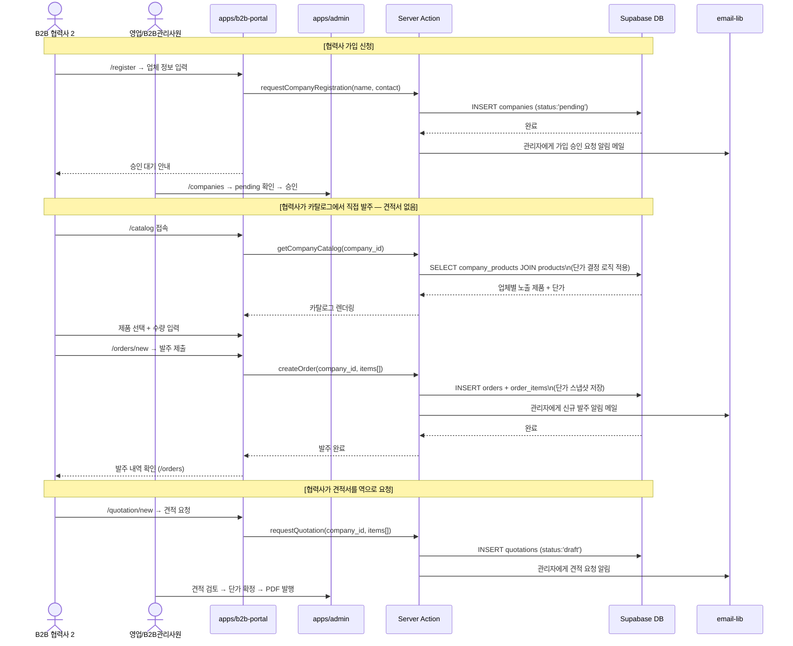
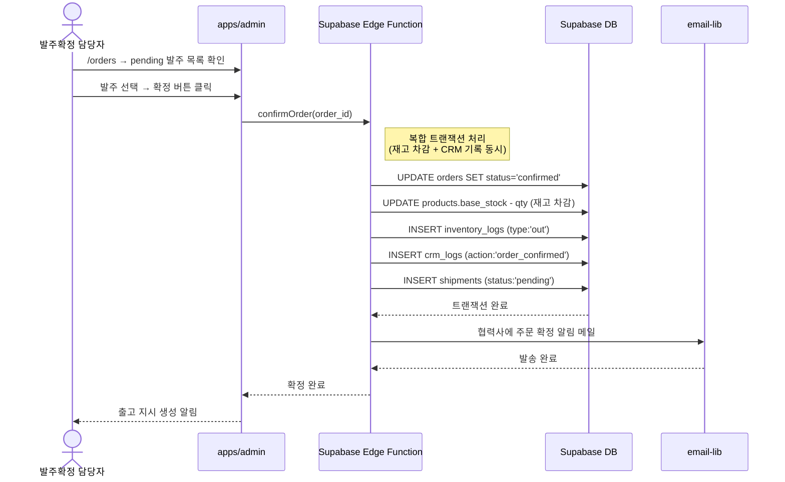
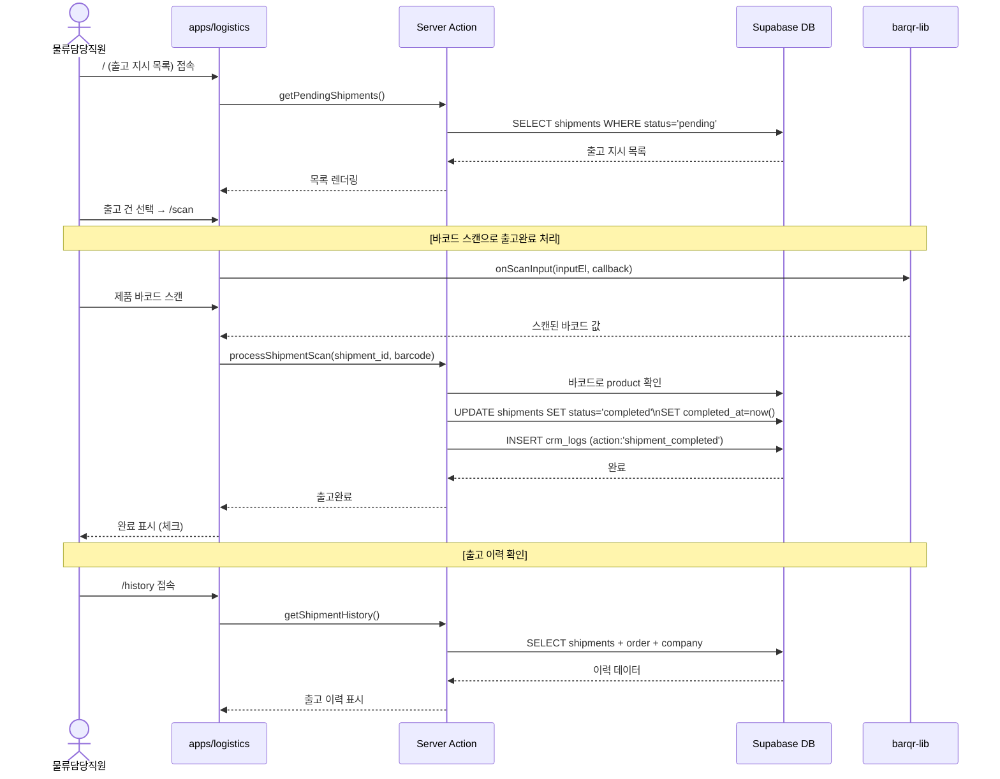
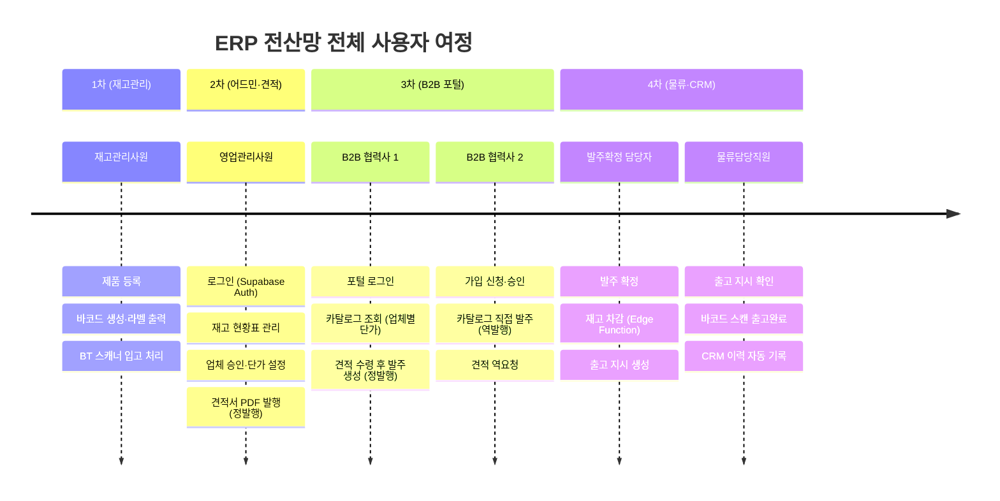
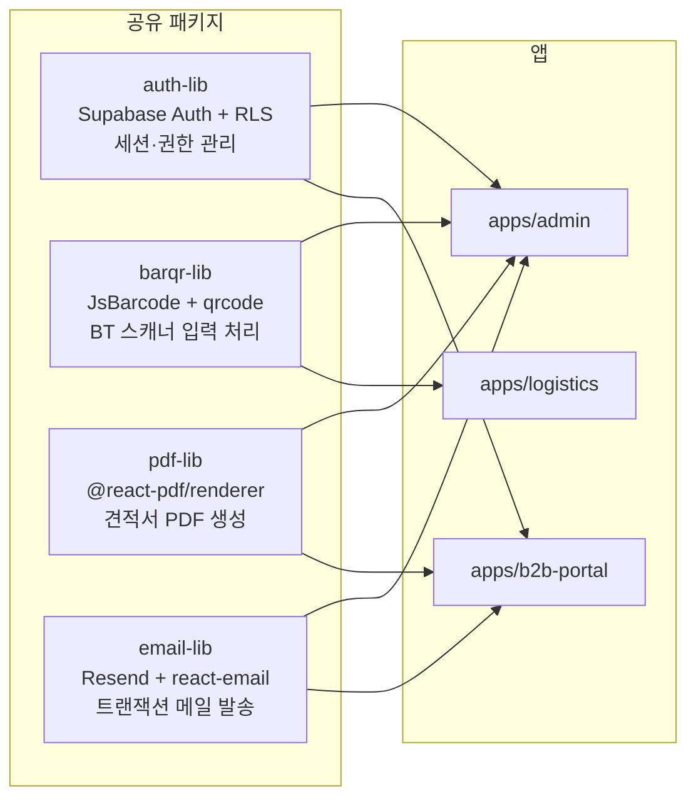

# ERP 전산망 — 사용자 시나리오 차트

> 작성일: 2026-03-06
> 대상: 재고관리사원, 물류담당직원, B2B 협력사(정발행/역발행)

---

## 전체 시스템 흐름 개요

---

## 시나리오 1 — 재고관리사원: 제품 등록 & 바코드 입고

> **1차 구현** | 앱: `apps/admin` | 패키지: `barqr-lib`

---

## 시나리오 2 — 영업/B2B 관리사원: 업체 승인 & 단가 설정

> **2~3차 구현** | 앱: `apps/admin` | 패키지: `auth-lib`

---

## 시나리오 3 — 정발행 발주 (어드민 주도)

> **2~3차 구현** | 앱: `apps/admin` + `apps/b2b-portal` | 패키지: `pdf-lib`, `email-lib`

---

## 시나리오 4 — 역발행 발주 (협력사 주도)

> **3차 구현** | 앱: `apps/b2b-portal` | 패키지: `email-lib`

---

## 시나리오 5 — 발주 확정 담당자: 주문 확정 & 재고 차감

> **4차 구현** | 앱: `apps/admin` | 패키지: `email-lib`, Supabase Edge Function

---

## 시나리오 6 — 물류담당직원: 출고 처리

> **4차 구현** | 앱: `apps/logistics` | 패키지: `barqr-lib`

---

## 시나리오 7 — 전체 흐름 타임라인 (4차 완성 시)

---

## 패키지별 사용 흐름 요약

---

## 핵심 제약 사항 요약

| 규칙 | 내용 |
|------|------|
| 단가 결정 | `pdf-lib`는 단가 계산 안 함. 항상 호출 측(Server Action)에서 결정 후 전달 |
| 보안 | `SUPABASE_SERVICE_ROLE_KEY` 및 `RESEND_API_KEY` 클라이언트 노출 금지 |
| 트랜잭션 | 재고 차감 + CRM 기록 복합 트랜잭션은 Supabase Edge Function에서 처리 (4차~) |
| RLS | 업체별 데이터 격리는 반드시 RLS 정책으로 처리 |
| 발주 확정 | 클라이언트에서 직접 재고 차감·발주 확정 처리 금지 |
